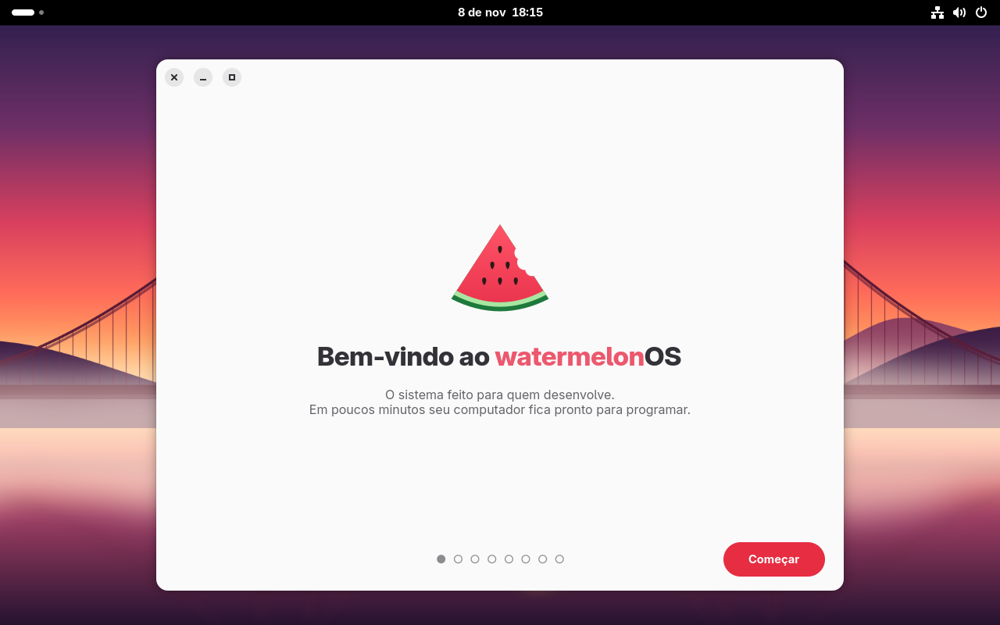
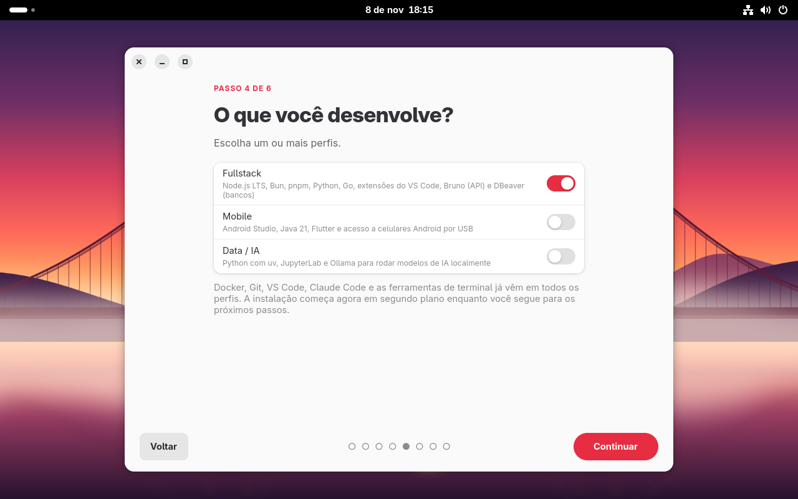
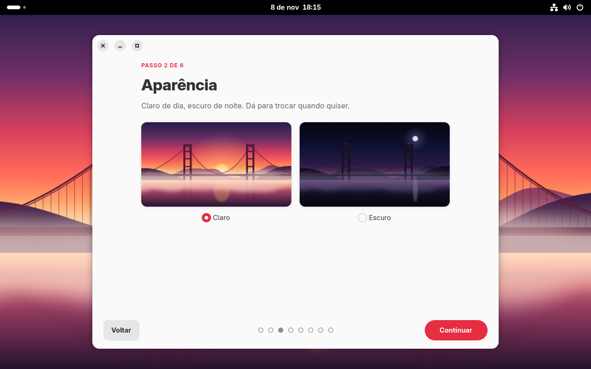

<p align="center">
  
</p>

<h1 align="center">watermelonOS</h1>

<p align="center"><b>O sistema operacional feito para quem desenvolve.</b><br>
Instale, entre no GitHub e no Claude, e em minutos seu computador está pronto para programar.</p>

<p align="center">
  <a href="https://carlospinellowork.github.io/watermelon-os/"><b>🌐 Site</b></a> ·
  <a href="#-instalar"><b>🍉 Instalar</b></a> ·
  <a href="#%EF%B8%8F-atalhos"><b>⌨️ Atalhos</b></a> ·
  <a href="https://github.com/carlospinellowork/watermelon-os/releases/latest"><b>⬇️ Downloads</b></a>
</p>

<p align="center">
  
</p>

---

## ✨ Recursos

| | |
|---|---|
| 👋 **Assistente de boas-vindas** | Wi-Fi, aparência, navegador, perfis, GitHub e Claude em poucos cliques |
| 🔑 **GitHub em 1 minuto** | `melon setup git`: login, chave SSH criada e enviada, commits assinados |
| 🤖 **Claude Code nativo** | já instalado, com login no primeiro boot |
| 🧰 **Perfis de dev** | **Fullstack** (Node, Bun, pnpm, Python, Go), **Mobile** (Android Studio, Java, Flutter), **Data/IA** (uv, Jupyter, Ollama) |
| 🐳 **Docker + VS Code** | Docker sem `sudo`, Dev Containers, VS Code configurado |
| 📦 **Instala qualquer coisa** | `melon install` abre `.exe`, `.apk`, `.deb`, `.rpm` e AppImage. Ou dois cliques no arquivo |
| 🎵 **Apps que todo mundo usa** | Spotify, Flameshot, conta-gotas de cor e OCR já vêm instalados |
| 🎨 **Do seu jeito** | barra em ilhas de vidro, botões 🔴🟡🟢 nas janelas, cursor do macOS e o app **Personalizar** (`melon personalizar`): cursor, ícones, papel de parede, cores, fontes e dock |
| 🏝️ **Ilha dinâmica** | a música tocando aparece junto do relógio, com capa e controles |
| 🚦 **GitHub na barra** | bolinha verde/amarela/vermelha com seus builds do GitHub Actions, e aviso quando terminam |
| 🍉 **Menu melancia, widgets e Dock em Arco** | atalhos do sistema no canto, relógio/sistema/música na área de trabalho e dock que abre em arco na lateral |
| 🧭 **Paleta de comandos** | <kbd>Super</kbd>+<kbd>K</kbd>: tema, foco, Wi-Fi, print, portas, repositórios, calculadora… tudo digitando |
| 🌿 **Ilhas de Git e Claude** | branch e mudanças do projeto atual (commit, push, PR); o Claude Code avisa quando está trabalhando, precisa de você ou terminou |
| 🔌 **Portas abertas** | seus servidores de dev (localhost:3000…) na barra: abrir no navegador ou encerrar |
| 🍅 **Modo foco** | Pomodoro na barra com não perturbe (`melon foco`) |
| 🔐 **Cofre de envs** | `melon env`: variáveis dos projetos criptografadas no chaveiro, carregadas sozinhas ao entrar na pasta, modo dev/PROD no prompt |
| 🧹 **Manutenção** | `melon limpar` (lixo e caches), `melon seguranca` (nota de segurança), `melon doctor` (saúde do sistema) |
| 🎬 **Gravar a tela** | <kbd>Super</kbd>+<kbd>Shift</kbd>+<kbd>R</kbd>: vídeo ou GIF (Kooha) · sons do sistema próprios |
| 🛡️ **Nunca quebra** | atualizações automáticas e atômicas, com volta à versão anterior pelo menu de boot |
| ⚡ **Leve** | nada roda à toa: Docker, Android e Windows só ligam quando você usa |

<p align="center">
  
  
</p>

## ⌨️ Atalhos

O melhor do Mac, do Windows e do Linux:

| Atalho | O que faz | Inspirado em |
|---|---|---|
| <kbd>Super</kbd> + <kbd>Espaço</kbd> | Busca: apps, arquivos, calculadora | 🍎 Spotlight |
| <kbd>Espaço</kbd> num arquivo | Pré-visualiza sem abrir | 🍎 Quick Look |
| <kbd>Super</kbd> + <kbd>V</kbd> | Histórico da área de transferência | 🪟 Windows |
| <kbd>Super</kbd> + <kbd>.</kbd> | Emojis | 🪟 Windows |
| <kbd>Super</kbd> + <kbd>←</kbd> / <kbd>→</kbd> | Encaixa janelas lado a lado | 🪟 Snap Layouts |
| <kbd>Ctrl</kbd> + <kbd>Shift</kbd> + <kbd>Esc</kbd> | Gerenciador de tarefas | 🪟 Windows |
| <kbd>Super</kbd> + <kbd>E</kbd> | Arquivos | 🪟 Windows |
| <kbd>Super</kbd> + <kbd>D</kbd> | Mostra a área de trabalho | 🪟 Windows |
| <kbd>Shift</kbd> + <kbd>Super</kbd> + <kbd>S</kbd> | Print de uma área (também <kbd>Print</kbd>) | 🪟 Captura |
| <kbd>Ctrl</kbd> + <kbd>Print</kbd> | Print com anotações (Flameshot) | 🐧 Linux |
| <kbd>F12</kbd> | Terminal suspenso | 🐧 Quake |
| <kbd>Ctrl</kbd> + <kbd>Alt</kbd> + <kbd>T</kbd> | Terminal | 🐧 Linux |
| <kbd>Super</kbd> + <kbd>Q</kbd> | Fecha a janela | 🍎 Mac |
| <kbd>Alt</kbd> + <kbd>Tab</kbd> | Alterna janelas (<kbd>Super</kbd> + <kbd>Tab</kbd>: apps) | 🪟 🍎 |
| <kbd>Super</kbd> + <kbd>N</kbd> | Notificações e calendário | 🍎 Mac |

E mais: **aviso quando um comando longo termina** (✅/❌), **celular integrado** (arquivos, notificações e área de transferência com Android), **Night Shift** automático e **manter acordado** com um clique.

## 🖥️ Terminal

Ghostty + zsh já configurados:

- **sugestões enquanto digita** (<kbd>→</kbd> aceita) e cores que mostram se o comando existe
- <kbd>Tab</kbd> com **busca e prévia** · <kbd>Ctrl</kbd>+<kbd>R</kbd> **histórico em tela cheia**
- **prompt com git**, versões de Node/Python e tempo do comando
- `lazygit` (`lg`), `lazydocker` (`ld`), `yazi` (`y`), `delta`, `fzf`, `ripgrep`, `zoxide` (`z`), `btop`, `tldr`
- **comandos do sistema**: `melon setup git`, `melon install <arquivo>`, `melon status`

## 🍉 Instalar

**🪟 Pelo Windows, sem pendrive (dual boot).** Para PCs com dois discos: baixe o instalador em [Releases](https://github.com/carlospinellowork/watermelon-os/releases/latest), escolha o disco livre (o do Windows fica bloqueado) e reinicie. Ao ligar, você escolhe entre WatermelonOS e Windows.

**🐧 Pelo Linux que você já usa, sem pendrive** (Ubuntu, Mint, Debian, Fedora…). Seus arquivos vêm junto:

```bash
curl -fsSL https://raw.githubusercontent.com/carlospinellowork/watermelon-os/main/install/from-linux.sh | bash
```

**💾 Com pendrive.** Baixe a ISO em [Releases](https://github.com/carlospinellowork/watermelon-os/releases/latest) e grave com o Balena Etcher ou o Rufus.

## 🛠️ Desenvolver o WatermelonOS

```bash
make build      # constrói a imagem do sistema
make qcow2      # disco de VM para testes
make vm         # liga a VM (usuário melon / senha melon)
make vm-ssh     # terminal dentro da VM
make raw        # disco pronto para o instalador do Windows
make iso        # ISO instalável
```

| Pasta | O que tem |
|---|---|
| `Containerfile` | a definição do sistema inteiro |
| `build_files/` | scripts do build: pacotes, terminal, desktop, marca |
| `system_files/` | arquivos copiados para a raiz do sistema |
| `branding/` | logo, ícones e wallpapers (fontes: `logo.svg`, `wallpaper.py`) |
| `install/` | instaladores sem pendrive (Linux e Windows) |
| `docs/` | o site |
| `tools/` | testes em VM |

Atualizações: o GitHub Actions constrói a imagem todo dia e publica em `ghcr.io/carlospinellowork/watermelon-os`; os computadores baixam e aplicam sozinhos.

<p align="center">Feito com 🍉 no Brasil · Licença MIT</p>
