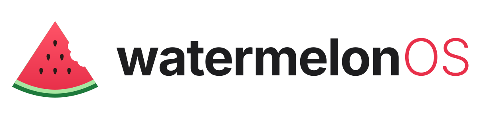

<p align="center">
  
</p>

<p align="center"><b>O sistema operacional feito para quem desenvolve.</b><br>
Instale, faça login no GitHub e no Claude, e em minutos seu computador está pronto para programar.</p>

---

## Por que WatermelonOS?

- **Pronto para programar.** Docker, VS Code, Git, Claude Code e um terminal turbinado (Ghostty + zsh com autocomplete, histórico inteligente e prompt com git) já vêm configurados.
- **Assistente de boas-vindas.** Wi-Fi, aparência, navegador, perfis (Fullstack, Mobile, Data/IA), GitHub e Claude, tudo em poucos cliques.
- **`melon setup git`.** Login no GitHub, chave SSH criada e enviada, commits assinados. Um comando.
- **`melon install`.** Programas do Windows (`.exe`), apps Android (`.apk`), `.deb`, `.rpm` e AppImage com dois cliques.
- **Nunca quebra.** Atualizações automáticas e atômicas: baixadas em segundo plano, aplicadas no próximo boot e com a versão anterior sempre disponível no menu de boot.
- **O melhor de cada sistema.** Quick Look (Espaço), Spotlight (`Super+Espaço`), histórico da área de transferência (`Super+V`), emoji (`Super+.`), Snap Layouts, terminal suspenso (`F12`), gerenciador de tarefas (`Ctrl+Shift+Esc`) e celular integrado (GSConnect).

## Instalar

**Sem pendrive**, a partir do Linux que você já usa (Ubuntu, Mint, Debian, Fedora…):

```bash
curl -fsSL https://raw.githubusercontent.com/carlospinellowork/watermelon-os/main/install/from-linux.sh | bash
```

Seus arquivos não são apagados: no primeiro login o assistente oferece trazer sua pasta pessoal.

**Com pendrive:** baixe a ISO na página de [Releases](../../releases) e grave com o Fedora Media Writer, Balena Etcher ou `dd`.

## Desenvolver o WatermelonOS

```bash
make build      # constrói a imagem do sistema
make qcow2      # gera um disco de VM para testes
make vm         # liga a VM (usuário melon / senha melon)
make vm-ssh     # terminal dentro da VM
make iso        # gera a ISO instalável
```

| Pasta | O que tem |
|---|---|
| `Containerfile` | a definição do sistema inteiro |
| `build_files/` | scripts do build (pacotes, terminal, desktop, marca) |
| `system_files/` | arquivos copiados para a raiz do sistema |
| `branding/` | logo, ícones e wallpapers (fonte: `logo.svg`, `wallpaper.py`) |
| `install/` | instalação sem pendrive |
| `tools/` | utilitários de teste em VM |

Feito com 🍉 no Brasil.
